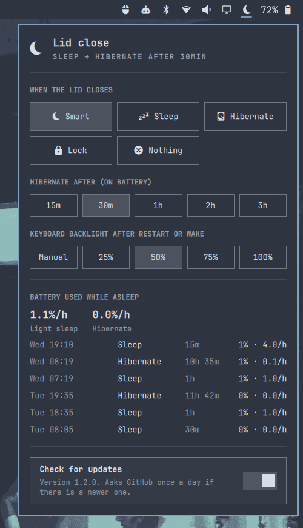

# Lid sleep for Omarchy

Stop your laptop draining its battery with the lid closed, the way Windows 11 does it,
and have the keyboard backlight come back on by itself when you open it.



Many newer laptops (Framework 13 AMD, recent Intel/AMD ultrabooks) only support
**s2idle** "modern standby", a light sleep that keeps using about 1% of battery per hour.
Windows gets around this by hibernating after a while. Linux can too, but it
isn't turned on by default. This plugin turns it on and adds a bar widget to control it.

| Lid closed for... | What happens | Battery use (Framework 13 AMD) |
|---|---|---|
| Less than the delay | Light sleep, instant wake | ~1%/hour |
| Longer, on battery | Hibernates to disk | ~0%/hour |
| Any time, on AC | Stays in light sleep | — |
| External monitor connected | Nothing (clamshell mode) | — |

## Keyboard backlight

Linux often forgets the keyboard backlight. Omarchy turns it off before
hibernating so the laptop can power down cleanly, but nothing turns it back on,
so after a hibernate or a restart you come back to dark keys and have to press
the backlight key every time.

Pick a level under **Keyboard backlight after restart or wake** and the plugin looks after it:

| When | Keyboard backlight |
|---|---|
| Power on, restart, wake from sleep or hibernate | On, at the level you picked |
| Disk password screen | On, so you can see the keys to type it |
| Asleep or hibernating | Off |
| Lid closed, even while docked to a monitor | Off |
| Lid opened again | Back on |

Leave it on **Manual** (the default) and the plugin doesn't touch the backlight.
The backlight keys still work; your picked level returns at the next wake,
lid open, or boot. The option only appears on laptops with a keyboard backlight.

## Install

Set up hibernation first, if you haven't already (needs a reboot):

```sh
omarchy hibernation setup
```

Then add the plugin and put it on the bar:

```sh
omarchy plugin add https://github.com/Daferia/omarchy-lid-sleep.git
omarchy plugin enable daferia.lid-sleep --before omarchy.power
```

Click the moon icon and pick **Smart**. You'll be asked for your password, because
the plugin changes system settings.

Optional: to also get the `lid-sleep` terminal command:

```sh
~/.config/omarchy/plugins/daferia.lid-sleep/bin/lid-sleep install
```

## The widget

- **When the lid closes:** Smart (sleep, then hibernate), Sleep, Hibernate, Lock, or Nothing
- **Hibernate after:** 15m / 30m / 1h / 2h / 3h (Smart mode only)
- **Keyboard backlight after restart or wake:** Manual, or 25 / 50 / 75 / 100% (see [Keyboard backlight](#keyboard-backlight))
- **Battery used while asleep:** average drain per sleep type, plus your recent sleeps

## Command line

```
lid-sleep status               current settings and recent sleeps
lid-sleep set windows [DELAY]  sleep, then hibernate after DELAY (default 60min)
lid-sleep set suspend|hibernate|lock|ignore
lid-sleep delay 30min          change the hibernate delay
lid-sleep backlight 50         keyboard backlight at 50% while awake, off while asleep or lid closed
lid-sleep backlight manual     stop managing the keyboard backlight
lid-sleep history              battery used during each recent sleep
lid-sleep test-hibernate       hibernate now to check that it works
lid-sleep remove               undo everything
```

## What it changes

All changes are systemd drop-in files, so `lid-sleep remove` undoes them completely:

- `/etc/systemd/logind.conf.d/30-lid-sleep.conf`: what the lid switch does
- `/etc/systemd/sleep.conf.d/30-lid-sleep.conf`: hibernate delay, and no hibernating on AC
- `/usr/lib/systemd/system-sleep/lid-sleep-log`: logs battery % before and after each sleep to `/var/lib/lid-sleep/history`
- `/usr/lib/systemd/system-sleep/lid-sleep-kbd-backlight` and `/etc/systemd/system/lid-sleep-kbd-backlight.service`: only if you pick a keyboard backlight level
- `/etc/initcpio/{install,hooks}/lid-sleep-kbd-backlight` and `/etc/mkinitcpio.conf.d/zz-lid-sleep-kbd-backlight.conf`: also only with a backlight level. They light the keys on the disk password screen, so the boot image is rebuilt each time you change the level (about 20 seconds)

Requires systemd 254 or newer.

## Uninstall

```sh
lid-sleep remove        # or: ~/.config/omarchy/plugins/daferia.lid-sleep/bin/lid-sleep remove
omarchy plugin remove daferia.lid-sleep
```
