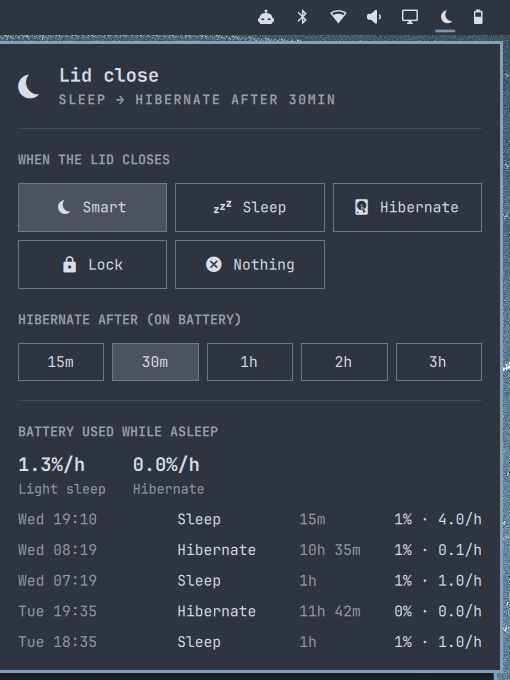

# Lid sleep for Omarchy

Stop your laptop draining its battery with the lid closed, the way Windows 11 does it.



Many newer laptops (Framework 13 AMD, recent Intel/AMD ultrabooks) only support
**s2idle** "modern standby", a light sleep that keeps using about 1% of battery per hour.
Windows gets around this by hibernating after a while. Linux can too, but it
isn't turned on by default. This plugin turns it on and adds a bar widget to control it.

| Lid closed for... | What happens | Battery use (Framework 13 AMD) |
|---|---|---|
| Less than the delay | Light sleep, instant wake | ~1%/hour |
| Longer, on battery | Hibernates to disk | ~0%/hour |
| Any time, on AC | Stays in light sleep | — |
| External monitor connected | Nothing (clamshell mode) | — |

## Install

Set up hibernation first, if you haven't already (needs a reboot):

```sh
omarchy hibernation setup
```

Then add the plugin and put it on the bar:

```sh
omarchy plugin add https://github.com/Daferia/omarchy-lid-sleep.git
omarchy plugin enable daferia.lid-sleep --before omarchy.power
```

Click the moon icon and pick **Smart**. You'll be asked for your password, because
the plugin changes system settings.

Optional: to also get the `lid-sleep` terminal command:

```sh
~/.config/omarchy/plugins/daferia.lid-sleep/bin/lid-sleep install
```

## The widget

- **When the lid closes:** Smart (sleep, then hibernate), Sleep, Hibernate, Lock, or Nothing
- **Hibernate after:** 15m / 30m / 1h / 2h / 3h (Smart mode only)
- **Battery used while asleep:** average drain per sleep type, plus your recent sleeps

## Command line

```
lid-sleep status               current settings and recent sleeps
lid-sleep set windows [DELAY]  sleep, then hibernate after DELAY (default 60min)
lid-sleep set suspend|hibernate|lock|ignore
lid-sleep delay 30min          change the hibernate delay
lid-sleep history              battery used during each recent sleep
lid-sleep test-hibernate       hibernate now to check that it works
lid-sleep remove               undo everything
```

## What it changes

All changes are systemd drop-in files, so `lid-sleep remove` undoes them completely:

- `/etc/systemd/logind.conf.d/30-lid-sleep.conf`: what the lid switch does
- `/etc/systemd/sleep.conf.d/30-lid-sleep.conf`: hibernate delay, and no hibernating on AC
- `/usr/lib/systemd/system-sleep/lid-sleep-log`: logs battery % before and after each sleep to `/var/lib/lid-sleep/history`

Requires systemd 254 or newer.

## Uninstall

```sh
lid-sleep remove        # or: ~/.config/omarchy/plugins/daferia.lid-sleep/bin/lid-sleep remove
omarchy plugin remove daferia.lid-sleep
```
